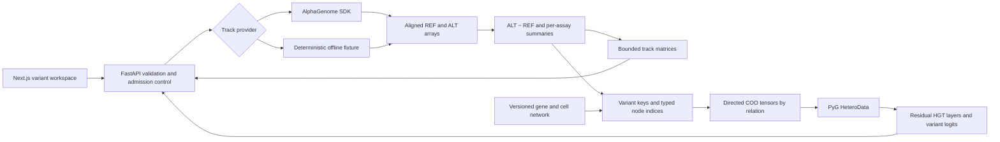

# GNN-AlphaDriver architecture

## Scope

The application ranks candidate non-coding single-nucleotide variants for research. AlphaGenome predicts changes in molecular assays. A separate heterogeneous graph model estimates a somatic driver label from those changes and a versioned biological network. A regulatory effect and a cancer driver label describe different phenomena. The bundled signals, network, and model weights are synthetic fixtures for exercising the stack. The UI labels their scores as demonstrations. Experimental inference requires a compatible checkpoint and matching gene and cell-type annotations.

## Data flow

## Contracts

| Boundary | Representation and invariant |
|---|---|
| Request | Human GRCh38 primary chromosomes 1–22, X, Y. A variant key contains normalized chromosome, 1-based position and two distinct single-base A/C/G/T alleles. The request also names a supported biosample and model window. |
| Provider | The user selects 100 kb or 1 Mb. SDK widths are 131,072 and 1,048,576 bases. Internal intervals are zero-based and half-open. Shift near chromosome boundaries to preserve the width. |
| Tracks | Each column is a contiguous 1D signal at a native resolution, and each row is a genomic bin. Subtract aligned columns in their native units. Preserve names and strands, and represent absent assays explicitly. RNA-seq, ATAC and CAGE use the selected biosample. Splice-site tracks describe donor and acceptor positions independent of tissue. |
| Features | For each assay, compute mean absolute delta, maximum absolute delta and a presence flag. Read them in a fixed, versioned order. Summaries use native bins before any visualization downsampling. |
| Node and edge data | Dense features per node type. A hash map assigns stable row indices to identifiers. Each directed relation holds a deduplicated int64 COO tensor of shape `[2, E]`, including `[2, 0]` for an empty relation. |
| API response | Return REF, ALT and delta matrices with aligned bin edges and column metadata. Average aligned native bins to a bounded view. Report track and model provenance independently. |

## Complexity and limits

- Arrays offer constant-time offset access and contiguous scans. For L bins and T tracks, subtraction costs O(LT). One 1 Mb float32 track costs 4 MiB per allele. Request only the selected biosample for tissue-specific outputs. The SDK exempts tissue-independent splice sites from the ontology filter. Process one delta column at a time. The SDK materializes the returned matrices before the application can inspect them.
- Variant and node lookup are expected O(1) under normal hash distribution. Constructing a key from its bounded fields is constant-size work. Testing a fixed number of equality calls across map sizes verifies that lookup avoids a scan without relying on machine-specific latency thresholds.
- COO costs O(E) storage for each relation. Building indices uses O(V + E) memory and avoids an O(V²) adjacency matrix. Bidirectional relations support two-hop paths from genes and cell types back to variants. Residual updates preserve isolated nodes. Attention computes messages only along stored edges, with additional dense projections on node features.
- Bound per-request graph size, chart points and process concurrency. Use fast rejection with HTTP 503 when inference capacity is exhausted. Keep the SDK retry policy as the only retry layer and return stable error codes for upstream failures. Revisit quotas and distributed admission control before increasing worker count.
- Start with one worker and no persistent cache. A shared cache would need bounded byte size and keys that include assembly, alleles, biosample, window, outputs and provider revision. A persisted checkpoint needs an independently recorded data and model version.

## Scientific checks

Validate the REF allele against the selected reference for experimental runs. The SDK permits substituting an arbitrary REF base. Configure an indexed GRCh38 FASTA for reference validation and require it when serving a research checkpoint. Offline requests validate coordinates and allele syntax using synthetic tracks. Limit this version to SNVs so alternate-sequence bin shifts cannot contaminate delta values. Keep tissue-independent splice sites visible in the track metadata.

Use curated evidence to construct variant–gene edges for training and held-out inference. Gene activity or regulatory proximity by itself does not establish that a variant drives a tumor. Keep graph annotations label-independent, split by patient and genomic locus before graph construction, and hold out tumor types for transfer evaluation. The 0.1% prevalence in the brief is a stress-test assumption. Measure prevalence in the cohort and report average precision, precision at a fixed review budget, and calibration under the target prevalence. A sigmoid model output becomes a probability estimate only after evaluation and calibration. Per-assay deltas describe signal changes, and an optional assay masking diagnostic measures model sensitivity.

## References

- [AlphaGenome API and model output metadata](https://www.alphagenomedocs.com/exploring_model_metadata.html)
- [AlphaGenome variant scoring and coordinate alignment](https://www.alphagenomedocs.com/variant_scoring.html)
- [GRCh38 chromosome sizes](https://www.ncbi.nlm.nih.gov/grc/human/data?asm=GRCh38)
- [Heterogeneous Graph Transformer](https://arxiv.org/abs/2003.01332)
- [Focal Loss](https://arxiv.org/abs/1708.02002)
